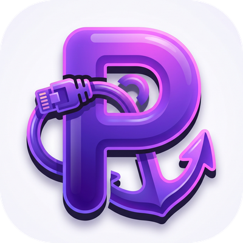

<p align="center">
  <picture>
    <source media="(prefers-color-scheme: dark)" srcset="docs/assets/portly-logo-dark.png">
    
  </picture>
</p>

# Portly — Local App Studio

Portly is a free, open-source desktop app for Windows, macOS, and Linux that starts, stops, monitors, and logs the local web apps and dev servers you work on, all from one window.

Made by **DNG Web Solutions** and released as freeware under the [MIT License](LICENSE).

## Get Portly running

You do not need to know how to code to install Portly. It takes about five minutes.

1. **Download the file.** Open the [latest release](https://github.com/juniortheshooter/portly/releases/latest) and scroll to **Assets**. On Windows, choose the file that starts with `Portly-Setup`. On a Mac, choose the `.dmg` file.
2. **Install Portly.**
   - **Windows:** double-click the `Portly-Setup` file. If a blue box says "Windows protected your PC", select **More info** and then **Run anyway**.
   - **Mac:** open the `.dmg` file and drag Portly into the Applications folder.
   - **Linux:** right-click the `.AppImage` file, allow it to run as a program in its properties, and double-click it.
3. **Open the app.** On Windows, open the Start menu and type Portly. On a Mac, right-click Portly in Applications and choose **Open** the first time.
4. **Add your project.** Select **Add Project**, then **Browse**, and choose the folder that holds your website or app. Portly reads the folder and enters the start command for you. Select **Add Project** again to save it.
5. **Press Start.** **Start** runs the project, and **Start & Open** also opens it in your browser. Press **Stop** when you are done.

Portly runs each project with the tools that are already on your computer. A Node.js project needs [Node.js](https://nodejs.org), and a Python project needs Python.

---

## Features

- **Detects 30+ stacks automatically.** JavaScript and TypeScript (npm, pnpm, yarn, Bun, Next.js, Vite, Astro, Remix, Nuxt, SvelteKit, Angular, Express, Fastify, Koa, Hono), Deno, Python (FastAPI, Django, Flask, Streamlit, Gradio, with `.venv` support), Go, Rust, PHP (Laravel, Symfony), Ruby (Rails, Jekyll), Java and Kotlin, C# and .NET, Elixir, Flutter Web, Docker Compose, and plain HTML.
- **Handles port conflicts for you.** When two apps want the same port, Portly picks a free one and passes it to the app.
- **Live logs.** See stdout and stderr as they happen, filter and search them, and export a crash report with one click.
- **Runs in the background.** Close the window and your servers keep running from the system tray.
- **Portable setups.** Save your project list and layout to a `.json` file and load it on another computer.
- **Private by design.** Everything runs on your computer. There is no telemetry, no account, and no cloud service. The control panel only listens on `127.0.0.1`.

---

## Download

Get the latest version from the [Releases page](https://github.com/juniortheshooter/portly/releases/latest).

| System  | File | Notes |
|---------|------|-------|
| Windows | `Portly-Setup-<version>-win-x64.exe` | Installer with Start Menu shortcut and uninstaller |
| Windows | `Portly-Portable-<version>-win-x64.exe` | Single file, no install needed |
| macOS   | `Portly-<version>-mac-<arch>.dmg` | Drag to Applications |
| Linux   | `Portly-<version>-linux-x86_64.AppImage` / `.deb` | AppImage runs anywhere; `.deb` for Debian and Ubuntu |
| Any     | `Portly-OpenSource-<version>-MultiOS.zip` | Source edition, needs Node.js 18 or newer |

### First launch warnings

Portly's builds are not code-signed yet, so your system may warn you the first time:

- **Windows:** SmartScreen shows "Windows protected your PC". Click **More info**, then **Run anyway**.
- **macOS:** Right-click Portly in Applications, choose **Open**, then confirm.
- **Linux AppImage:** Make it executable first: `chmod +x Portly-*.AppImage`.

You can check that a download is genuine by comparing it with `SHA256SUMS.txt` from the same release:

```bash
sha256sum -c SHA256SUMS.txt --ignore-missing      # Linux
shasum -a 256 -c SHA256SUMS.txt --ignore-missing  # macOS
```

On Windows PowerShell, run `Get-FileHash .\Portly-Setup-*.exe` and compare the result with the file.

---

## Running the source edition

The source edition needs [Node.js](https://nodejs.org) 18 or newer. The Portly server itself has no npm dependencies.

1. Unzip `Portly-OpenSource-<version>-MultiOS.zip`.
2. Start it with the launcher for your system:
   - **Windows:** double-click `Start-Portly-App.bat` or `Portly-Desktop.vbs`.
   - **macOS:** double-click `Start-Portly.command` or `Portly.app`.
   - **Linux:** run `./start-portly.sh`.

This opens Portly in an app-style window of Chrome, Edge, Brave, or Chromium, whichever you have installed. On macOS and Linux you may need to run `chmod +x Start-Portly.command start-portly.sh Portly.app/Contents/MacOS/Portly` once.

To use the full desktop shell with a system tray instead, run `npm install` and then `npm run electron`.

---

## Let AI coding agents control Portly

Portly includes an [MCP](https://modelcontextprotocol.io) server, so AI coding agents can start and stop your dev servers, read their logs, and register new projects for you. It works with Claude Code, OpenAI Codex, Gemini CLI, Google Antigravity, Cursor, VS Code, and any other agent that supports MCP.

Once connected, you can say things like "start my shop project and tell me the URL" or "the API crashed, check its logs".

**What the agent can do:** list projects, check status, start, stop, restart, read logs, detect what kind of project a folder is, add a project, and stop everything. It cannot delete projects or change your settings.

**What you need:**
1. Portly is running (open the app, or the source edition).
2. [Node.js](https://nodejs.org) 18 or newer.
3. The full path to `portly-mcp.js`:
   - **Source edition or cloned repo:** the file sits in the Portly folder.
   - **Windows installer:** `%LOCALAPPDATA%\Programs\Portly\resources\app.asar.unpacked\portly-mcp.js`

In the examples below, replace `/path/to/portly-mcp.js` with that path. On Windows, use forward slashes in JSON and TOML (`C:/Users/you/Portly/portly-mcp.js`). If the path contains spaces, put it in quotes in the one-line commands, for example `node "C:/Users/you/My Projects/portly-mcp.js"`.

### Claude Code
```bash
claude mcp add --scope user portly -- node /path/to/portly-mcp.js
```

### OpenAI Codex (CLI and IDE extension)
```bash
codex mcp add portly -- node /path/to/portly-mcp.js
```
Or add this to `~/.codex/config.toml`:
```toml
[mcp_servers.portly]
command = "node"
args = ["/path/to/portly-mcp.js"]
```

### Gemini CLI
```bash
gemini mcp add portly node /path/to/portly-mcp.js
```
Or add this to `~/.gemini/settings.json`:
```json
{
  "mcpServers": {
    "portly": { "command": "node", "args": ["/path/to/portly-mcp.js"] }
  }
}
```

### Google Antigravity
Open the agent panel, choose the MCP servers option from its menu, then **Manage MCP Servers** and **View raw config** (this edits `mcp_config.json`). Add:
```json
{
  "mcpServers": {
    "portly": { "command": "node", "args": ["/path/to/portly-mcp.js"] }
  }
}
```
Menu names change between Antigravity versions. If you can't find it, look for "MCP" in the agent settings.

### Cursor
Add the same `mcpServers` block to `~/.cursor/mcp.json`. For VS Code, put it in `.vscode/mcp.json` under the key `servers` instead of `mcpServers`.

### No Node.js installed? Use the app itself
The installed Portly app can run the server for you. Use the installed `Portly.exe` as the command and set `ELECTRON_RUN_AS_NODE`:
```json
{
  "mcpServers": {
    "portly": {
      "command": "C:/Users/you/AppData/Local/Programs/Portly/Portly.exe",
      "args": ["C:/Users/you/AppData/Local/Programs/Portly/resources/app.asar.unpacked/portly-mcp.js"],
      "env": { "ELECTRON_RUN_AS_NODE": "1" }
    }
  }
}
```

### Agents that only run shell commands
Any agent that can run a terminal command can use the command line tool instead:
```bash
node portly-cli.js list
node portly-cli.js start "my project"
node portly-cli.js logs "my project" --lines 30
node portly-cli.js stop "my project"
node portly-cli.js add /path/to/folder --name "My Project"
```
Run `node portly-cli.js help` for the full list.

### Different port
Portly listens on port 4567 by default. If you changed it with the `PORT` variable, set `PORTLY_URL=http://127.0.0.1:<port>` in the agent's environment.

### Is this safe?
- The MCP server talks to the agent over standard input and output. It opens no network port.
- It only connects to Portly on your own computer, and Portly still refuses requests from websites.
- An agent that can add a project and set its start command can run programs on your computer, just like it could from a terminal. Only connect agents you already trust with your machine, and keep each agent's own permission prompts turned on.

---

## A note on safety

Portly runs the start commands you give it, the same way a terminal would. Only add projects and import `.json` config files that you trust, because a config file can contain any command. Portly never starts a project on its own; it only runs commands when you press Start.

Portly's local control panel refuses requests from other websites, so a page you visit in your browser can't add or start projects. To report a security problem, see [SECURITY.md](SECURITY.md).

---

## Building from source

```bash
npm install          # installs Electron and electron-builder
npm test             # runs the cross-platform test suite
npm run electron     # runs the desktop app from source

npm run dist:win     # Windows installer and portable .exe (run on Windows)
npm run dist:mac     # macOS .dmg and .zip (run on macOS)
npm run dist:linux   # Linux .AppImage and .deb (run on Linux)
npm run release      # after dist:win, collects files, checksums and the source zip into ./release
```

When building on Windows in PowerShell, use `npm.cmd` instead of `npm` if your execution policy blocks scripts, and set `$env:CSC_IDENTITY_AUTO_DISCOVERY = "false"` to skip code-signing.

Tests write to a temporary data folder if you set `DEVDECK_DATA_DIR`, which keeps your own project list untouched:

```bash
DEVDECK_DATA_DIR="$(mktemp -d)" npm test
```

### Project website

The `docs/` folder is the Portly landing page. It is plain HTML, CSS and one small script, with its fonts bundled, so it makes no outside requests. It is published with GitHub Pages (Settings, Pages, deploy from the `main` branch and `/docs` folder) and can be copied into any other website.

After forking or renaming the repository, run `node scripts/set-repo.js your-github-name/portly` to point every link at your copy.

### Automated releases

Pushing a tag such as `v1.2.0` runs the GitHub Actions workflow in `.github/workflows/release.yml`. It runs the tests, builds Windows, macOS, and Linux packages on their own systems, and publishes them with a `SHA256SUMS.txt` file as a GitHub Release. Bump `version` in `package.json` before tagging, so the file names match the tag.

---

## Contributing

See [CONTRIBUTING.md](CONTRIBUTING.md).

## License

Portly is free software released under the [MIT License](LICENSE).
